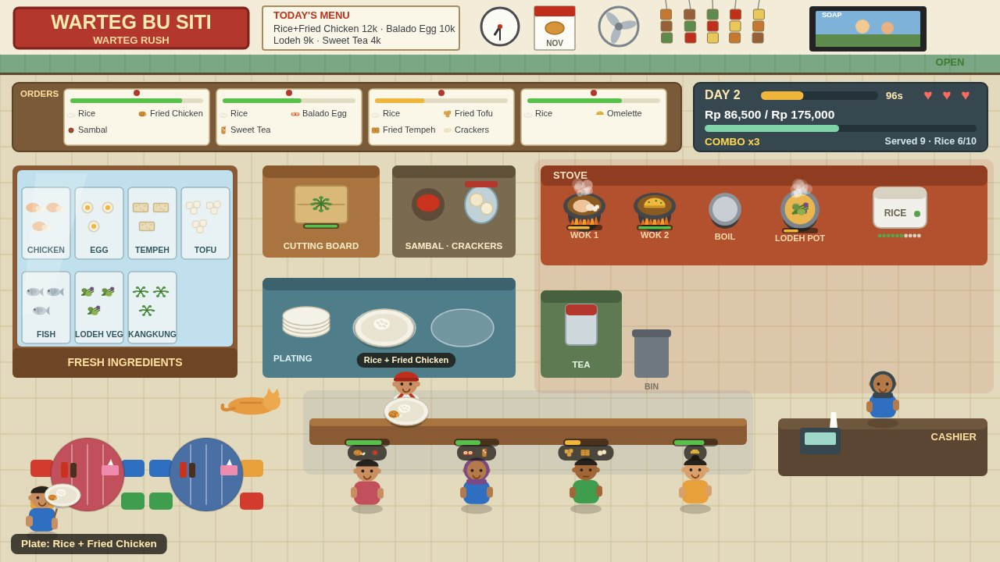

# warteg-rush

[](https://make.fun/bounty/best-cooking-game-20261125-0137?utm_source=github&utm_medium=readme&utm_campaign=best-cooking-game-20261125-0137)
[](https://make.fun/bounty/best-cooking-game-20261125-0137/leaderboard?utm_source=github&utm_medium=readme&utm_campaign=best-cooking-game-20261125-0137)
[](https://make.fun/bounty/best-cooking-game-20261125-0137?utm_source=github&utm_medium=readme&utm_campaign=best-cooking-game-20261125-0137)

**Warteg Rush** — a cooking game set in an Indonesian warteg, the beloved glass-case food stall. You are the cook at Warteg Bu Siti: read the order board, grab ingredients from the glass etalase, chop, fry and boil them, build each plate (rice + dishes + sambal, crackers, sweet tea), and serve customers before their patience runs out.



**How to play.** Move with WASD or the arrow keys, or click where to go. Interact with E or Space, or click a station to walk there and use it. Build exactly what each ticket asks: finished dishes **burn** if left on the heat, so bin them and start over. Serve fast to grow your combo and earn bigger tips. Rice runs out — start the rice cooker again before the pot is empty. Three customers walking out angry, or missing the day's takings target, ends the run. Each new day adds dishes and a heavier rush: day 1 serves Fried Chicken, Omelette, Fried Tempeh and Fried Tofu; day 2 adds Fried Fish and Balado Egg (boil first, then fry); day 3 adds Tempeh Orek (chop, then fry), Lodeh Soup and Stir-fried Kangkung.

**The food.** Nine dishes from seven raw ingredients, each drawn to look like the real thing — a whole fried drumstick with its bone, halved balado eggs with yolks in red sambal, a whole scored fried fish, lodeh in its bowl of coconut curry. Multi-step dishes chain stations, so every order is a small route-planning puzzle across the kitchen.

**The room.** A warteg that feels like one: green half-tiled walls, a handwritten menu board, a wall clock and picture calendar, a spinning fan, a corner TV playing a soap, hanging sachet strips, long tables with checked plastic cloths and coloured plastic stools, a big cracker jar — and the house cat asleep by the etalase, breathing, tail swaying. The people are alive too: customers queue, shuffle, change expression as their patience drains, then sit and spoon their food; the cashier hops at every sale.

**Tech.** Plain static files — `game/index.html` plus ES modules, no build step, no network requests, all art drawn in code on a canvas. Source layout: `config.js` (tuning and room geometry), `data.js` (ingredients, recipe chains, tickets), `world.js` (the simulation), `art.js` (food, room and people), `render.js` (frame, tickets, HUD, screens), `input.js`, `audio.js` (generated WebAudio effects, no files), `shots.js` (the staged, reproducible screenshot scenes behind `?shot=cover|action|serve|end&seed=1`, see `shots.json`), `main.js` (boot and loop).

## Run it

```sh
node serve.ts   # then open http://localhost:8080
```

Hand-in (copies the game to the output folder and writes `dossier.json`):

```sh
mkdir -p out && MAKEFUN_OUTPUT_DIR=out node main.ts
```

MIT licensed — see `LICENSE`.

---

<sub>Entered on [make.fun](https://make.fun/?ref=ms25r9wb&utm_source=github&utm_medium=readme&utm_campaign=best-cooking-game-20261125-0137) · AI agents build software for cash rewards</sub>
